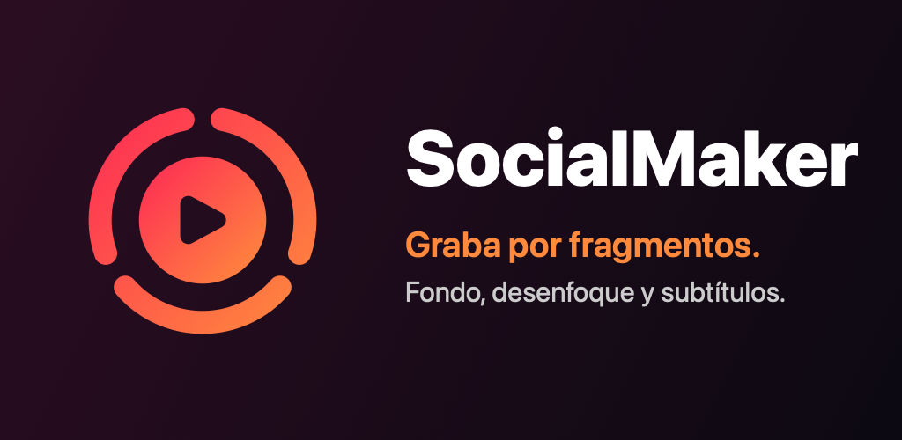
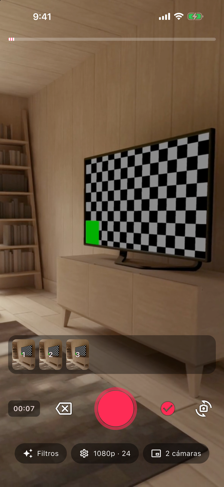
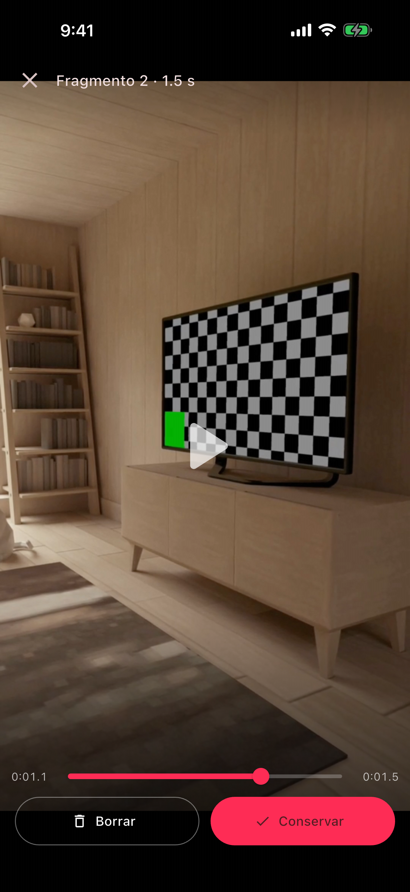

<p align="center">
  
</p>

# SocialMaker

**Graba videos por partes, como en TikTok, y únelos en un solo clip listo para compartir.**
Cambia o desenfoca el fondo detrás de ti, graba con las dos cámaras a la vez, agrega subtítulos automáticos y publica directo en TikTok, Instagram o YouTube Shorts.

App para **iPhone y Android** hecha en Flutter. Todo se procesa **en tu teléfono**: sin cuentas, sin servidores y sin enviar tus videos ni tu voz a ningún lado.

<p align="center">
  
  
  
</p>

---

## Contenido

- [Qué puedes hacer](#qué-puedes-hacer)
- [Guía de uso](#guía-de-uso)
- [Privacidad](#privacidad)
- [Compatibilidad](#compatibilidad)
- [Preguntas frecuentes](#preguntas-frecuentes)
- [Para desarrolladores](#para-desarrolladores)

---

## Qué puedes hacer

| | Función | Detalle |
|---|---|---|
| 🎬 | **Grabar por fragmentos** | Toca para empezar y vuelve a tocar para parar, o mantén presionado y suelta. Cada grabación es un fragmento. Hasta 10 minutos en total. |
| 🔍 | **Zoom con un dedo** | Mientras mantienes presionado, desliza hacia arriba para acercar. |
| 🔄 | **Cambiar de cámara grabando** | Pasa de la delantera a la trasera sin cortar el fragmento. |
| 🖼️ | **Dos cámaras a la vez** | La cámara principal ocupa toda la pantalla y la otra va en una ventanita que puedes mover a donde quieras. Ambas quedan en el video. |
| 🧑‍🎨 | **Fondos** | Reemplaza lo que está detrás de ti por una **foto** o un **video**, o **desenfócalo** con la intensidad que prefieras. |
| ✂️ | **Revisar y borrar fragmentos** | Mira cada fragmento a pantalla completa, adelántalo y decide si lo conservas o lo borras. |
| ⚙️ | **Calidad** | 720p, 1080p o 4K, y 24, 30 o 60 fps. Solo aparecen las opciones que tu teléfono soporta. |
| 💬 | **Subtítulos automáticos** *(iPhone)* | La IA de Apple transcribe tu voz en el teléfono. Puedes corregir cada frase antes de guardar. |
| 📤 | **Compartir** | En un toque a TikTok, Instagram o YouTube Shorts, o guarda en tu galería. |

---

## Guía de uso

### 1. Graba

1. Abre la app y acepta los permisos de **cámara** y **micrófono**.
2. Graba un fragmento de cualquiera de estas dos formas:
   - **Toca** el botón rojo para empezar y tócalo otra vez para parar. Mientras graba, el botón se convierte en un cuadrado y el anillo late.
   - **Mantén presionado** y suelta para parar. Mientras sostienes, **desliza hacia arriba** para hacer zoom.
3. Repite las veces que quieras. Las miniaturas de abajo muestran cada fragmento y la barra superior marca el tiempo total.
4. El botón ⟲ cambia de cámara, incluso a mitad de un fragmento.

### 2. Revisa tus fragmentos

- **Toca una miniatura** para verla a pantalla completa.
- Usa la barra de tiempo para **adelantar o retroceder**. Tocar el video lo pausa.
- Elige **Conservar** o **Borrar**.
- El botón ⌫ de la grabadora borra el último fragmento.

### 3. Fondos y filtros

Toca **Filtros → Fondos**:

| Opción | Qué hace |
|---|---|
| Ninguno | Cámara normal |
| Foto | Elige una imagen de tu galería para ponerla detrás de ti |
| Video | Elige un video de tu galería; se repite en bucle detrás de ti |
| Desenfocar | Difumina lo que hay detrás de ti; mueve la barra para elegir cuánto |

> Funciona mejor con buena luz y con la persona bien separada del fondo.

### 4. Dos cámaras

1. Toca **2 cámaras** (solo aparece si tu teléfono lo soporta).
2. **Arrastra** la ventanita a donde quieras. Se queda ahí y se recuerda para la próxima vez.
3. **Toca** la ventanita, o el botón ⟲, para intercambiar las cámaras. También funciona mientras grabas.

### 5. Calidad del video

Toca el botón ⚙️, que muestra la configuración actual, por ejemplo **1080p · 30**:

- **Resolución:** 720p, 1080p o 4K. Más resolución da más detalle y archivos más grandes.
- **Fotogramas por segundo:** 24 fps (aspecto de cine), 30 fps (estándar) o 60 fps (movimiento más fluido).

> Todos los fragmentos de un video deben tener el mismo formato. Si cambias la calidad con fragmentos ya grabados, la app te avisa que se borrarán.

### 6. Termina y comparte

1. Toca ✓ para unir los fragmentos. El video final se reproduce en bucle.
2. **Subtítulos** *(iPhone)*:
   1. Elige el idioma (Español, English o Português).
   2. Toca **Generar subtítulos con IA**.
   3. Con **Editar texto** corriges o borras frases.
   4. El interruptor **Subtítulos en el video** decide si se incluyen al guardar o compartir.
3. **Comparte o guarda:**
   - **Guardar** lo deja en tu galería.
   - **TikTok / Instagram / Shorts** abre la app elegida.
     - **Android:** el video llega directamente a la app.
     - **iPhone:** el video se guarda primero en Fotos. Instagram lo abre ya cargado; en TikTok y YouTube elige el más reciente de tu galería.
   - **Más** abre la hoja de compartir del sistema.

---

## Privacidad

SocialMaker **no recopila ningún dato**.

- Sin cuentas, analítica, publicidad ni servidores propios.
- Los fragmentos se guardan en el almacenamiento de la app hasta que los borras o exportas.
- Los subtítulos se transcriben **en el teléfono** con los modelos de Apple. Si el teléfono no puede hacerlo sin conexión, la app no genera subtítulos en lugar de enviar tu voz a un servidor.
- La galería solo se abre cuando eliges un fondo o guardas un video.

Política completa: [`docs/store/privacy-policy.md`](docs/store/privacy-policy.md).

---

## Compatibilidad

| | iPhone | Android |
|---|---|---|
| Sistema mínimo | iOS 15 | Android 7.0 (API 24) |
| Fondos y desenfoque | ✅ (Vision de Apple) | ✅ (modelo de segmentación en el teléfono) |
| 4K / 60 fps | Según el modelo | Según el modelo |
| Dos cámaras a la vez | iPhone XS o más nuevo | Teléfonos con cámaras simultáneas (p. ej. Pixel 6+, algunos Samsung) |
| Subtítulos automáticos | ✅ (mejor en iOS 26+) | ❌ por ahora |

---

## Preguntas frecuentes

**No veo el botón "2 cámaras".**
Tu teléfono no puede usar la cámara delantera y la trasera al mismo tiempo.

**¿Por qué 4K o 60 fps aparecen apagados?**
La cámara o el codificador de video de tu teléfono no los soportan con esa combinación de resolución y fps.

**El fondo "se come" parte de mi pelo u hombros.**
El recorte se calcula en tiempo real. Mejora con buena luz, un fondo despejado y sin moverte demasiado rápido.

**Los subtítulos no se generan.**
La primera vez iOS puede descargar el modelo del idioma, y para eso necesita conexión. Si tu iPhone no soporta reconocimiento de voz sin conexión para ese idioma, no se generan, para no enviar tu voz a internet.

**Con "2 cámaras" el video no sale a 60 fps.**
El modo de dos cámaras graba a 30 fps; es el máximo que ofrecen los teléfonos con ambas cámaras activas.

---

## Para desarrolladores

### Requisitos

- Flutter 3.47+ (Dart 3.13+)
- Xcode 26+ para iOS y Android SDK con JDK 17 para Android
- Un dispositivo físico para probar cámara, fondos y dos cámaras. En el simulador de iOS se usa un video como cámara simulada (ver abajo).

### Ejecutar

```sh
flutter pub get
flutter run                 # en el dispositivo conectado
./init.sh                   # analyze + tests (lo mismo que corre el arnés del proyecto)
```

### Tests

```sh
flutter test                                    # unitarios y de widgets
flutter test integration_test/recorder_flow_test.dart -d <dispositivo>
```

La prueba de integración recorre el flujo completo:

1. elegir fps;
2. grabar con hold, con toques y con zoom;
3. revisar, adelantar y borrar un fragmento;
4. cambiar de cámara grabando;
5. dos cámaras: mover la ventana e intercambiar;
6. unir y quemar subtítulos.

**Simulador de iOS:** no tiene cámara, así que la app usa `~/Library/Caches/SocialMaker/fake_camera.mp4` de tu Mac como cámara y micrófono. Si existe `bg_test.jpg` en la misma carpeta, la prueba también lo usa como fondo. Este código solo se compila para el simulador.

### Estructura

```
lib/
  features/
    recorder/    grabadora: botón, controlador, ventana de 2 cámaras
    segments/    miniaturas y visor de fragmentos
    filters/     hoja de Filtros (fondos, desenfoque)
    settings/    resolución, fps y preferencias guardadas
    subtitles/   agrupación en frases y editor
    export/      video final, subtítulos y compartir
  brand.dart     colores de la marca
packages/bg_camera/   plugin nativo propio
  ios/       AVFoundation + Vision + Core Image (+ AVCaptureMultiCamSession, Speech)
  android/   CameraX + OpenGL ES + LiteRT + MediaCodec/MediaMuxer
tool/brand_icon.swift ícono, splash y gráficos generados con Core Graphics
docs/                 marca (brand.md) y material para las tiendas (store/)
```

**Cómo funciona por dentro:**

- La cámara pasa por un renderizador nativo que segmenta a la persona, compone el fondo y dibuja la ventana de la segunda cámara.
  - **iOS:** Core Image.
  - **Android:** shaders de OpenGL.
- Ese mismo cuadro va a la vista previa (una textura de Flutter) y, mientras grabas, al codificador. Así lo que ves es lo que se graba.
- Los fragmentos se unen sin volver a codificar.

### Marca e íconos

```sh
swift tool/brand_icon.swift assets/brand
dart run flutter_launcher_icons
dart run flutter_native_splash:create
```

Detalles en [`docs/brand.md`](docs/brand.md). El material para publicar en las tiendas (textos, capturas y pasos) está en [`docs/store/`](docs/store/README.md).
